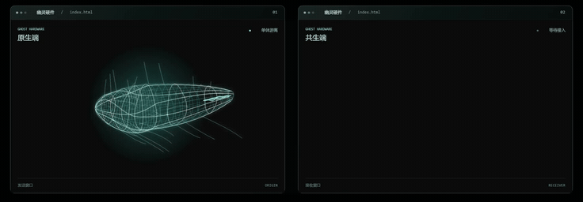
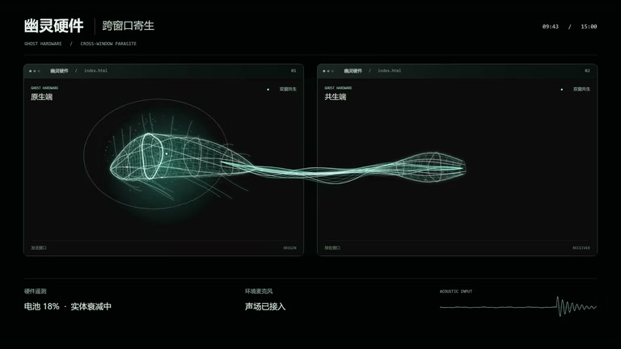

# Ghost Hardware · 幽灵硬件：跨窗口寄生

[Open the demo · 在线试玩](https://daoruidu.github.io/ghost-hardware/) · [Watch the film · 看成片](https://github.com/daoruidu/ghost-hardware/releases/download/v1.0.0/Ghost-Hardware-Light-50fps.mp4) · [Download HTML · 离线版](https://github.com/daoruidu/ghost-hardware/releases/download/v1.0.0/index.html)

A wireframe creature lives in one browser window. Open a second window and drag it to the other side of your screen. A single filament now spans both panes. Tap the desk with the microphone enabled and a bright ring travels along it.

## Run it

Open the [live demo](https://daoruidu.github.io/ghost-hardware/) in a desktop browser and click **打开共生窗口 ↗**. Place the two windows side by side. You can also download the standalone HTML and open it locally. If your browser blocks the popup, allow it or open the same online URL in a second window.

| Input | Effect |
| --- | --- |
| Move either window | The strand changes direction to reach its partner. |
| Click the canvas, or focus it and press Space | Send a pulse through both windows. |
| Click **开启麦克风**, then tap the desk | A sound peak makes the body contract and launches a pulse. Click **关闭麦克风** to stop listening. |
| Close the second window | The creature returns to its solitary form. |

## Inside the file

Everything lives in [index.html](index.html), about 15 KiB. `stage()` maps the two viewports onto one coordinate plane. The windows exchange their positions and pulse timestamps over `BroadcastChannel`. `paint()` draws each visible section with Canvas 2D, reusing vertices for the rings and the lengthwise strands.

Microphone samples stay in the window that requested access. Its partner receives the sound level and pulse time. When the browser supplies battery telemetry, a discharging battery below 25% slows the creature's motion.

## 中文

用桌面浏览器打开[在线试玩](https://daoruidu.github.io/ghost-hardware/)，点「打开共生窗口」，把两个窗口左右并排。先点一下左窗里的生物，看那圈亮光从哪儿进入右窗。再把右窗往上挪一点，触角会跟着转向。

想用声音触发，就点「开启麦克风」，轻敲一下桌面。也可以直接[下载单文件 HTML](https://github.com/daoruidu/ghost-hardware/releases/download/v1.0.0/index.html) 离线玩，或看 [15 秒有声演示](https://github.com/daoruidu/ghost-hardware/releases/download/v1.0.0/Ghost-Hardware-Light-50fps.mp4)。演示中的 18% 电量是预设值，网页会显示浏览器实际提供的读数。
